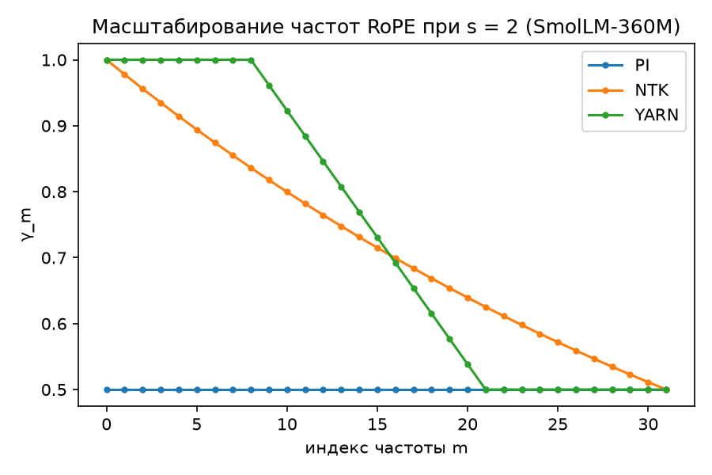
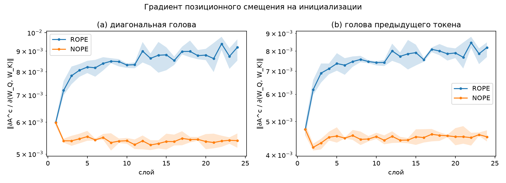
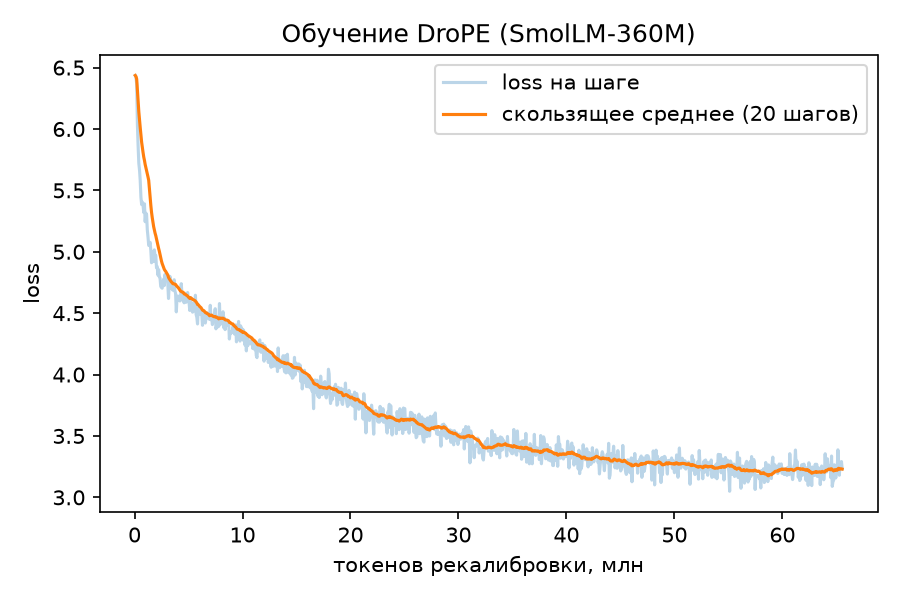
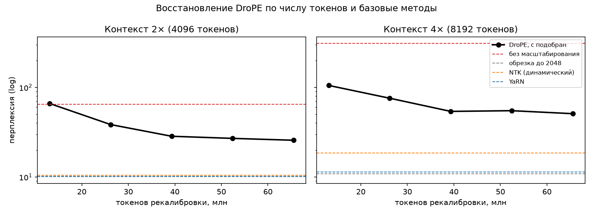

# Воспроизведение DroPE на SmolLM-360M

Курс «Эффективные NN», ИТМО. Статья: Gelberg, Eguchi, Akiba, Cetin, *Extending the Context of Pretrained LLMs by Dropping Their Positional Embeddings* (Sakana AI, arXiv 2512.12167). Наш код лежит в этом репозитории, код авторов мы подключили сабмодулем `third_party/DroPE` и не меняли.

Скрипт `src/report_tables.py` собирает этот отчёт из шаблона `report/report_template.md` и строит каждую таблицу из JSON-файлов в `results/`.

## 1. Утверждения статьи

Позиционные эмбеддинги (positional embeddings, PE: векторы, по которым модель различает порядок токенов) ускоряют обучение, но мешают модели читать тексты длиннее обучающих. Авторы опираются на три наблюдения.

1. **PE нужны для обучения.** Трансформер без PE (NoPE) по выразительности не уступает модели с PE, но учится медленнее: на инициализации веса его внимания близки к равномерным, и градиенты «позиционного смещения» малы. RoPE (rotary PE: поворот запросов и ключей на угол, зависящий от позиции) даёт модели это смещение с первого шага.
2. **RoPE мешает расширять контекст без дообучения (zero-shot).** Методы масштабирования частот (PI, NTK, YaRN) сжимают низкие частоты. На них работают «семантические» головы внимания, и на больших расстояниях их внимание смещается.
3. **PE можно убрать после предобучения.** Метод DroPE: взять обученную RoPE-модель, выключить вращение во всех слоях и дообучить её на исходной длине контекста (рекалибровка). По данным авторов, качество возвращается, а длинные последовательности модель обрабатывает без дополнительного обучения.

## 2. Объём воспроизведения

Мы взяли SmolLM-360M с контекстом обучения 2048 токенов и воспроизвели:

- анализ без обучения: частоты PI/NTK/YaRN (Fig. 6), Proposition 3.2 и градиенты позиционного смещения (Fig. 4);
- качество исходной модели в исходном контексте (Table 5);
- базовые методы расширения контекста на 2× и 4× (Table 10): без масштабирования, обрезка, PI, NTK, YaRN;
- рекалибровку DroPE и её оценку по перплексии и NIAH (needle-in-a-haystack, «иголка в стоге сена»: модель ищет в длинном тексте спрятанное семизначное число);
- LongBench на четырёх наборах из Table 2 (MultiFieldQA, MuSiQue, GovReport, LCC) в сокращённом виде. Этот прогон дал **недостоверные числа** из-за ошибки вычислений на Mac (подробности в приложении).

Обучение моделей с нуля (Table 1, 6), большие модели (Table 3) и головы внимания Qwen2.5 (Fig. 7–8) мы не воспроизводили.

## 3. Реализация

| Файл | Назначение |
|---|---|
| `src/positional.py` | режимы RoPE (PI, NTK, YaRN), загрузка DroPE-чекпоинта, температура внимания β |
| `src/ppl.py` | перплексия на заданной длине |
| `src/niah.py` | стенд NIAH |
| `src/long_context_eval.py` | оценка метода на длине 1×, 2×, 4× |
| `src/tune_beta.py` | подбор коэффициента температуры c |
| `src/analysis.py`, `src/run_analysis.py` | позиционное смещение, Fig. 4 и Fig. 6 |
| `src/quality_eval.py` | качество в исходном контексте (lm-eval-harness) |
| `src/longbench.py`, `src/longbench_eval.py` | LongBench: данные, промпты, метрики, генерация |
| `src/pretokenized_data.py`, `kaggle/` | данные и запуск рекалибровки на Kaggle |
| `scripts/evaluate_snapshots.sh` | оценка снимков весов: подбор c, перплексия и NIAH на 1×, 2×, 4× |
| `src/plot_results.py`, `src/report_tables.py` | графики и сборка отчёта из `results/` |

Рекалибровку запускает `train.py` авторов с нашим Hydra-конфигом `configs/run_cfg/drope_smollm360m_t4.yaml`. Веса после рекалибровки мы выложили на Hugging Face: https://huggingface.co/alexander-andreevich/SmolLM-360M-DroPE-66M.

На длинном контексте DroPE умножает логиты внимания на β = 1 + c·ln(s), где s означает кратность контекста. Коэффициент c мы подбираем перебором по перплексии на отложенных текстах целевой длины, как делают авторы. Тексты для подбора и тексты для итоговой перплексии не пересекаются.

## 4. Результаты без обучения

### 4.1. Масштабирование частот (Fig. 6)



Мы строим график по частотам, которые модель использует при s = 2. PI сжимает каждую частоту в 2 раза. NTK оставляет самую высокую частоту без изменений и сжимает остальные тем сильнее, чем ниже частота. YaRN не трогает высокие частоты и сжимает низкие в 2 раза. Тест `tests/test_positional.py` сверяет частоты с формулами статьи.

### 4.2. Proposition 3.2

Утверждение авторов: если NoPE-трансформер получает последовательность из одинаковых токенов, его внимание равномерно (α_ij = 1/i), градиенты по W_Q, W_K и градиент позиционного смещения равны нулю, а выход совпадает на всех позициях. Тесты `tests/test_analysis.py` проверяют каждое из этих свойств на NoPE-модели авторов. Для контроля тесты берут RoPE-модель той же формы и получают у неё ненулевой градиент.

### 4.3. Градиент позиционного смещения на инициализации (Fig. 4)



Мы взяли модель той же формы, что модель «с нуля» в Table 4 статьи (24 слоя, 14 голов, 2 KV-головы), со случайной инициализацией и тремя значениями seed. В таблице средняя норма градиента позиционного смещения по W_Q и W_K, умноженная на 1000:

| Голова | Модель | слой 1 | слой 12 | слой 24 |
|---|---|---|---|---|
| диагональная голова | ROPE | 5.99 | 9.00 | 9.20 |
| диагональная голова | NOPE | 5.98 | 5.39 | 5.40 |
| голова предыдущего токена | ROPE | 4.74 | 8.00 | 8.19 |
| голова предыдущего токена | NOPE | 4.74 | 4.53 | 4.51 |

У RoPE норма растёт от первого слоя к последнему, у NoPE остаётся около значения первого слоя. Так же выглядит график в статье, и авторы делают из него вывод, что у NoPE позиционные головы формируются медленнее. Абсолютные значения мы с авторскими не сравниваем: статья не называет данные и размер батча для этого графика.

### 4.4. Качество в исходном контексте (Table 5)

| Модель | ARC-E | ARC-C | HellaSwag | OpenBookQA | PIQA | Winogrande | Среднее |
|---|---|---|---|---|---|---|---|
| SmolLM-360M (статья) | 65.6 | 36.0 | 53.8 | 37.2 | 72.0 | 53.7 | 53.1 |
| SmolLM-360M-DroPE (статья) | 67.3 | 37.6 | 53.9 | 38.0 | 71.5 | 52.3 | 53.4 |
| SmolLM-360M (у нас) | 63.8 | 36.0 | 53.5 | 37.6 | 71.5 | 56.8 | 53.2 |
| DroPE (у нас) | 52.5 | 28.1 | 37.3 | 31.6 | 64.9 | 52.3 | 44.4 |

Среднее нашей базовой модели (53.2) совпадает со статьёй (53.1) с точностью до десятой. Финальный снимок DroPE набирает 44.4, а на Winogrande получает 52.3 при случайном уровне 50. По Table 5 статьи DroPE не уступает базовой модели после рекалибровки на 31–126 млрд токенов (Table 4), а в тексте авторы пишут, что больше 95% качества возвращается меньше чем за 5 млрд токенов. Наши 66 млн токенов составляют около 1.3% от этих 5 млрд.

### 4.5. Базовые методы на длинном контексте

Перплексия и точность NIAH (доля найденных иголок; 10 глубин по 10 попыток, 100 на ячейку; жадное декодирование):

| Метод | PPL 1× | NIAH 1×, % | PPL 2× | NIAH 2×, % | PPL 4× | NIAH 4×, % |
|---|---|---|---|---|---|---|
| без масштабирования | 12.02 | 90.0 | 64.72 | 0.0 | 309.09 | 0.0 |
| обрезка до 2048 |  |  | 10.05 | 50.0 | 10.91 | 30.0 |
| PI |  |  | 18.24 | 0.0 | 79.11 | 0.0 |
| NTK (статический, формула статьи) |  |  | 11.88 | 0.0 | 26.01 | 0.0 |
| NTK (динамический, HF) |  |  | 10.47 | 85.0 | 18.60 | 6.0 |
| YaRN |  |  | 10.14 | 76.0 | 11.33 | 37.0 |

Сравнение с Table 10 статьи (NIAH, %):

| Метод | 2×, статья | 2×, у нас | 4×, статья | 4×, у нас |
|---|---|---|---|---|
| NTK (статический, формула статьи) | 29.8 | 0.0 | 14.4 | 0.0 |
| YaRN | 48.2 | 76.0 | 25.6 | 37.0 |

Точность NIAH по глубине вставки иголки (0.00 соответствует началу текста, 1.00 концу), %:

| Контекст | Метод | 0.00 | 0.11 | 0.22 | 0.33 | 0.44 | 0.56 | 0.67 | 0.78 | 0.89 | 1.00 |
|---|---|---|---|---|---|---|---|---|---|---|---|
| 2× | обрезка до 2048 | 0 | 0 | 0 | 0 | 0 | 100 | 100 | 100 | 100 | 100 |
| 2× | YaRN | 0 | 10 | 80 | 80 | 90 | 100 | 100 | 100 | 100 | 100 |
| 4× | обрезка до 2048 | 0 | 0 | 0 | 0 | 0 | 0 | 0 | 100 | 100 | 100 |
| 4× | YaRN | 0 | 0 | 10 | 40 | 20 | 90 | 80 | 60 | 0 | 70 |

Наблюдения:

- За пределами контекста обучения модель без масштабирования находит 0% иголок. Её перплексия растёт в 5.4 раза при 2× и в 25.7 раза при 4×.
- Обрезка находит иголку только на глубинах, которые попадают в последние 2048 токенов.
- При 2× YaRN находит иголку на глубинах 0.22–0.44 в 80–90% случаев, а обрезка туда не дотягивается. На глубинах 0.00 и 0.11 YaRN находит иголку в 0 и 10% случаев, обрезка в 0. Тезис статьи «YaRN ведёт себя как обрезка контекста» наш стенд подтверждает для начала текста и опровергает для глубин 0.22–0.44. Абсолютная точность YaRN у нас выше, чем в Table 10.
- При 4× кривая YaRN немонотонна: на глубине 0.89 ноль, на 1.00 семьдесят процентов. Десять попыток на глубину дают слишком широкий разброс, и по отдельным глубинам мы выводов не делаем.
- Статический NTK по формуле статьи не нашёл ни одной иголки при перплексии 11.9 на 2× (у YaRN 10.1). Динамический NTK из `transformers` при 2× нашёл 85%. Причину расхождения со статьёй мы не установили. Гипотезы: авторы используют другой формат иголки и вопроса либо динамическое масштабирование, которое статья упоминает только для YaRN.

## 5. Рекалибровка DroPE

Настройки: все слои без RoPE, QKNorm (RMSNorm на запросах и ключах, как в коде авторов), lr 1e-3 с косинусным расписанием, AdamW (β = 0.9, 0.95; weight decay 0.1), fp16 с fp32-весами, две T4 на Kaggle.

Бюджет:

| Показатель | Значение |
|---|---|
| Токенов рекалибровки у нас | 66 млн |
| Токенов рекалибровки в статье | 31.46 млрд |
| Доля бюджета статьи | 0.21% |
| Шагов оптимизатора | 1000 |
| Токенов на шаг | 65536 |
| Trainer, 2×T4 (DDP), токенов/с суммарно | 1864 |
| Trainer, 2×T4 (DDP), токенов/с на карту | 932 |
| Ручной цикл, одна T4, токенов/с | 2351 |



Кривая восстановления по снимкам весов (c означает подобранный коэффициент температуры):

| Шаг | Токенов, млн | PPL 1× | c (2×) | PPL 2× | NIAH 2×, % | c (4×) | PPL 4× | NIAH 4×, % |
|---|---|---|---|---|---|---|---|---|
| 200 | 13 | 76.76 | 0.2 | 66.07 | 0.0 | 0.412 | 105.13 | 0.0 |
| 400 | 26 | 42.44 | 0.2 | 38.47 | 0.0 | 0.412 | 75.70 | 0.0 |
| 600 | 39 | 33.05 | 0.2 | 28.49 | 0.0 | 0.2 | 53.98 | 0.0 |
| 800 | 52 | 29.66 | 0.2 | 26.99 | 0.0 | 0.2 | 54.97 | 0.0 |
| 1000 | 66 | 29.17 | 0.2 | 25.72 | 0.0 | 0.2 | 50.90 | 0.0 |



Перебор температуры β на последнем снимке (подбор на отдельных отложенных текстах):

| c | PPL 2× | PPL 4× |
|---|---|---|
| 0.0 | 67.57 | 259.28 |
| 0.103 | 41.77 | 110.09 |
| 0.2 | 28.77 | 52.78 |
| 0.412 | 32.19 | 75.42 |
| 0.8 | 59.26 | 255.84 |

### Выводы по рекалибровке

1. **Перплексия DroPE падает с каждым снимком** на всех трёх длинах (1×, 2×, 4×), а между 39 и 66 млн токенов кривая выходит на плато. Косинусное расписание опускает lr до 2.7e-5 к шагу 900 и до нуля к шагу 1000, поэтому плато может объясняться расписанием, и по нему нельзя судить, остановилось бы улучшение при дальнейшем обучении.
2. **Температура внимания решает исход на длинном контексте.** На последнем снимке c = 0.2 снижает перплексию с 67.6 до 28.8 при 2× и с 259.3 до 52.8 при 4×. На сетке из пяти значений лучший c при 2× равен 0.2 на каждом снимке; при 4× он равен 0.412 на шагах 200 и 400 и 0.2 на шагах 600–1000. Авторы приводят 0.103 для SmolLM-DroPE и 0.412 для модели с нуля; сетку мы не уточняли.
3. **При 2× DroPE использует дополнительный контекст, при 4× нет.** При 2× перплексия ниже, чем при 1×, так же ведут себя YaRN и обрезка. При 4× перплексия выше, чем при 1×.
4. **По перплексии DroPE уступает YaRN, обрезке и динамическому NTK** на обеих длинах. Модель без масштабирования DroPE обходит при 4× с шага 200, а при 2× с шага 400; на шаге 200 при 2× у DroPE 66.1, у модели без масштабирования 64.7.
5. **NIAH равен нулю на каждом снимке и на каждой длине, включая исходный контекст 1×**, где базовая модель находит иголку в 90% случаев. Значит, за 66 млн токенов рекалибровка не вернула модели способность находить и копировать значение из контекста, и расширение контекста здесь ни при чём. Ошибку оценки мы исключили: на финальном снимке генерация с KV-кэшем и без него выдаёт одинаковый текст. Наша гипотеза: эта способность восстанавливается позже перплексии. Проверить её без большего бюджета мы не можем.

### Сравнение с утверждениями статьи

- Авторы пишут, что DroPE превосходит YaRN и NTK на NIAH. Наш эксперимент этот тезис не проверяет: при нашем бюджете DroPE не находит иголку даже в исходном контексте.
- Авторы пишут, что больше 95% качества возвращается меньше чем за 5 млрд токенов. Наша кривая охватывает первые 1.3% этого бюджета. Она показывает монотонное восстановление и ничего не говорит о пороге в 5 млрд.
- Авторы пишут, что длинному контексту нужна температура β. Мы подтверждаем: на каждом из пяти снимков лучший c ненулевой.

## 6. Отклонения от статьи

1. **Бюджет рекалибровки.** Таблица бюджета в разделе 5 показывает долю от бюджета статьи. Наши результаты описывают начало кривой восстановления.
2. **Батч и warmup.** Батч 65 536 токенов вместо 1 048 576, warmup 4% шагов вместо 490 шагов.
3. **Точность и внимание.** fp16 вместо bf16 и `sdpa` вместо FlashAttention-2: T4 не поддерживает ни bf16, ни FlashAttention-2.
4. **Данные.** Первые четыре файла `data0` набора `PrimeIntellect/fineweb-edu`, токенизированные заранее, вместо потока по всему fineweb-edu.
5. **Скорость обучения.** lr 1e-3, как в Table 4 статьи; в конфиге авторов стоит 3e-4.
6. **NIAH.** Стандартный вариант с одной иголкой (статья не называет вариант для Table 2 и 10), 100 попыток на ячейку, расчёт на Mac (MPS, fp32).
7. **Перплексия.** 16 отложенных последовательностей fineweb-edu из файлов, которые не входят в обучение.
8. **Качество в исходном контексте.** lm-eval-harness вместо lighteval. Lighteval конфликтует по зависимостям с Hydra из репозитория авторов, а его `piqa` по умолчанию использует буквенный формат ответа. Метрика: нормированная точность, для Winogrande обычная.
9. **LongBench.** По 60 случайных образцов на набор (одинаковых для всех методов), промпт до 2048 токенов для базовой модели и до 8192 (4×) для остальных вместо полной длины в статье (до 80×), bf16 на Mac. Промпты, усечение по середине и метрики мы взяли из оригинального LongBench. Строку PI мы не считали. Числа этого прогона недостоверны (приложение), пересчёт мы не делали.

## 7. Ошибки, найденные по ходу работы

- **Несовместимость кода авторов с `transformers` 4.56.2.** Внимание с QKNorm ждёт аргумент `past_key_value`, а слой передаёт `past_key_values`. KV-кэш при генерации остаётся пустым, и DroPE-модель проваливает NIAH. Наш загрузчик переадресует аргумент (`route_cache_to_qk_norm_attention`), код авторов мы не трогали. Тест `test_qk_norm_drope_generates_same_with_and_without_cache` ловит эту ошибку.
- **SDPA на MPS игнорирует параметр масштаба.** Сначала мы задавали температуру β через `scaling` внимания. На CPU это работает, а на MPS функция `scaled_dot_product_attention` пропускает `scale`, и перебор c выдавал одну и ту же перплексию при любом c. Мы заметили совпадение значений и перенесли β в веса `q_norm`: умножение запросов на β масштабирует логиты так же. Тест `test_temperature_changes_logits_on_mps_with_sdpa` проверяет исправление. Ошибка задела только расчёты с β ≠ 1.
- **SDPA в bf16 на MPS обрывает генерацию.** В LongBench модель выдавала токен конца текста первым же токеном ответа. Мы проверили это на шести образцах GovReport: `sdpa` даёт 6 пустых ответов из 6, `eager` при тех же весах и промптах 0 из 6 (`scripts/check_mps_sdpa.py`, `results/longbench/mps_sdpa_check.json`).
- **Медленный `Trainer` на Kaggle.** В пересчёте на одну карту `Trainer` в DDP выдаёт 932 токена/с, а ручной цикл на одной T4 2351 (таблица бюджета). В DDP часть времени уходит на синхронизацию градиентов, поэтому сравнение приближённое. Запуск `Trainer` на одной T4 мы тоже делали, но его лог не сохранили. Причину разрыва мы не нашли, и из-за него бюджет рекалибровки вышел меньше расчётного.

## 8. Запуск

`README.md` описывает порядок шагов. Основные команды:

```bash
python3 -m venv .venv && source .venv/bin/activate
pip install -r requirements.txt
pytest tests

# базовые методы (Mac, MPS)
PYTHONPATH=src:third_party/DroPE python src/long_context_eval.py --method yarn --scales 2 4

# рекалибровка (Kaggle)
python kaggle/prepare_tokens.py && bash kaggle/bundle_code.sh
kaggle kernels push -p kaggle/kernels/main

# оценка снимков, графики и сборка отчёта
bash scripts/evaluate_snapshots.sh
python src/plot_results.py && python src/report_tables.py
```

## Приложение: LongBench (числа недостоверны)

Числа этого приложения содержат ошибку вычислений, и сравнивать по ним методы нельзя. Мы оставили таблицы, чтобы показать масштаб ошибки.

**Причина.** Мы считали LongBench на Mac (MPS) в bf16 с вниманием `sdpa`, которое `transformers` выбирает по умолчанию. На этом пути генерация обрывается на первом токене: модель выдаёт токен конца текста. Обычная SmolLM без масштабирования вернула пустой ответ на каждый из 60 образцов GovReport.

**Проверка.** Скрипт `scripts/check_mps_sdpa.py` прогоняет шесть образцов GovReport через ту же функцию генерации с теми же весами и промптами. С `sdpa` все шесть ответов пустые, с `eager` пустых ответов нет, и модель пишет связный текст (`results/longbench/mps_sdpa_check.json`). Ошибку вносит `sdpa`, модель и протокол LongBench здесь ни при чём. Оригинальный `pred.py` никак не обрабатывает токен конца текста для задач MultiFieldQA, MuSiQue, GovReport и LCC, поэтому параметры генерации вроде `min_new_tokens` мы не меняли: они скрыли бы ошибку.

**Охват ошибки.** Мы считаем недостоверными все пять строк LongBench, включая DroPE и динамический NTK: пустых ответов у них меньше, но часть образцов могла пострадать так же. Перплексию, NIAH, подбор температуры и качество на шести задачах ошибка не задела: мы считали их в fp32 на MPS или на CPU.

**Исправление для пересчёта.** Запускать LongBench с `attn_implementation="eager"` в bf16 (мы проверили это на коротких промптах), в fp32 или на CUDA. Хватит ли памяти для 8192 токенов в режиме `eager`, мы не проверяли.

Баллы (F1 для MultiFieldQA и MuSiQue, ROUGE-L для GovReport, схожесть кода для LCC; от 0 до 100) рядом с Table 2 статьи (там длина до 80×, у нас до 8192 токенов):

| Метод | MultiFieldQA | MuSiQue | GovReport | LCC | Среднее |
|---|---|---|---|---|---|
| SmolLM (статья) | 4.03 | 0.40 | 4.48 | 5.99 | 3.7 |
| + PI (статья) | 13.68 | 2.45 | 5.67 | 11.52 | 8.3 |
| + RoPE-NTK (статья) | 18.87 | 4.89 | 23.71 | 8.26 | 13.9 |
| + YaRN (статья) | 20.78 | 4.77 | 15.03 | 10.87 | 12.9 |
| SmolLM-DroPE (статья) | 29.33 | 7.93 | 21.87 | 18.56 | 19.4 |
| без масштабирования, обрезка до 2048 (у нас) | 0.67 | 1.39 | 0.00 | 1.40 | 0.9 |
| NTK (статический), 4× (у нас) | 0.00 | 0.00 | 0.15 | 1.90 | 0.5 |
| NTK (динамический), 4× (у нас) | 7.92 | 0.80 | 2.69 | 8.82 | 5.1 |
| YaRN, 4× (у нас) | 1.67 | 0.00 | 0.03 | 2.43 | 1.0 |
| DroPE (step-1000), 4× (у нас) | 2.64 | 0.42 | 5.17 | 11.52 | 4.9 |

Число пустых ответов из 60 на набор:

| Метод | MultiFieldQA | MuSiQue | GovReport | LCC |
|---|---|---|---|---|
| без масштабирования, обрезка до 2048 | 18/60 | 14/60 | 60/60 | 40/60 |
| NTK (статический), 4× | 40/60 | 54/60 | 38/60 | 40/60 |
| NTK (динамический), 4× | 3/60 | 1/60 | 46/60 | 0/60 |
| YaRN, 4× | 17/60 | 24/60 | 58/60 | 30/60 |
| DroPE (step-1000), 4× | 2/60 | 1/60 | 0/60 | 0/60 |
