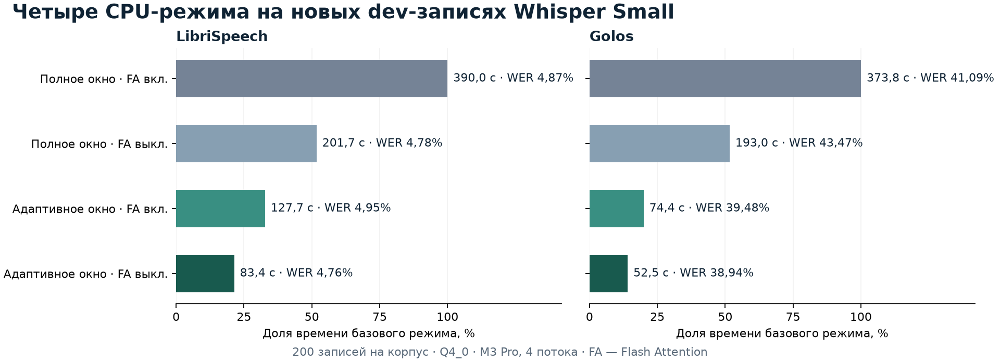

# GPTQ и адаптивное аудиоокно для Whisper Small

Александр Иванов · Apple M3 Pro · whisper.cpp v1.8.3

Собрал два GPTQ-чекпоинта Whisper Small в нативном Q4_0. В каждом обработал 72 линейных тензора encoder. Отдельно на штатном Q4_0 проверил полное и адаптивное аудиоокно с Flash Attention и без него. На 400 новых dev-записях адаптивное окно без Flash Attention ускорило полный CPU-прогон в **4,68× на LibriSpeech** и **7,11× на Golos** относительно того же Q4_0 с полным окном и включённым Flash Attention.

[Презентация](whisper-small-gptq.pptx) · [Как подключить модель к общему замеру](../docs/team-merge.md)

## GPTQ при том же формате и размере

Из одного Whisper Small F16 получил штатный Q4_0. В его копиях заменил только байты 72 выбранных тензоров. Для GPTQ-16 и GPTQ-64 использовал вложенные выборки из LibriSpeech train-clean-100. Собирал вторые моменты входных активаций исходного encoder, применял 1% демпфирования и записывал коды и FP16-шкалы прямо в блоки Q4_0. Деквантизация двух проверенных тензоров совпала с нативным GGML побайтно. Максимальные абсолютные ошибки матричного умножения составили 5,96 × 10⁻⁷ и 3,10 × 10⁻⁶. Все Q4_0-файлы занимают ровно 145 458 015 байт. F16 занимает 487 601 967 байт. [Код GPTQ](../q4.py) · [Калибровка](../calibrate.py) · [IDs и хеши](calibration.json)

Пилот включал по 32 записи из LibriSpeech dev-clean и Golos Farfield validation. Четыре CPU-потока, полное окно, Flash Attention включён, greedy с температурой 0, без VAD и timestamps. RTF включает загрузку модели, чтение аудио и запись JSON.

| Веса | WER EN | RTF EN | WER RU | RTF RU |
| --- | ---: | ---: | ---: | ---: |
| F16 | 2,35% | 0,227 | 30,57% | 0,449 |
| Штатный Q4_0 | 2,10% | 0,223 | 36,79% | 0,469 |
| GPTQ-16 | 2,35% | 0,223 | 34,72% | 0,461 |
| GPTQ-64 | 2,22% | 0,223 | 36,27% | 0,461 |

GPTQ-16 дал на Golos 67 ошибок против 71 у штатного Q4_0. На LibriSpeech получилось 19 против 17. На Golos четыре записи улучшились и две ухудшились. 95%-й парный bootstrap-интервал ΔWER на Golos составил **от −5,53 до +1,15 п.п.** Три варианта Q4_0 уложились в 2% разброса RTF внутри каждого корпуса. [WER, CER, RTF и память](gptq-pilot.csv)

## Что показали абляции

- **Attention и MLP.** На первых 16 записях Golos штатный Q4_0 дал 41 ошибку на 105 слов. GPTQ только для attention дал 41, только для MLP — 38, для всего encoder — 37. Первые и последние шесть блоков по отдельности дали по 38 ошибок.
- **Русская калибровка.** GPTQ на 16 записях Golos train дал 38 ошибок против 37 у английской калибровки на тех же dev-записях. Число кадров различалось, 2 939 против 9 817. По этому сравнению отдельно оценить вклад языка нельзя.
- **Демпфирование.** На трёх тензорах сравнил полные, диагональные и переставленные матрицы вторых моментов. На позднем MLP-тензоре относительный MSE на Golos снизился с 1,27 при 1% демпфирования до 0,90 при 10%. Для раннего attention-тензора лучше сработал 1%. Это измерение выхода слоя.

## Аудиоокно и Flash Attention на 400 новых dev-записях

По 200 новых записей каждого корпуса. Во всех четырёх режимах одни и те же штатные веса Q4_0, четыре CPU-потока и одинаковое декодирование. Адаптивный режим использует 512 позиций до 9,5 с, 1024 до 19,5 с и полное окно из 1500 позиций для более длинных записей. Режимы чередовались блоками из 25 файлов. Полное время включает запуск процессов, загрузку модели, чтение WAV и запись результатов. p95 измерен внутри вызова распознавания после загрузки модели.

| Окно и FA | WER EN | Время EN | WER RU | Время RU |
| --- | ---: | ---: | ---: | ---: |
| Полное, FA вкл. | 4,87% | 390,0 с | 41,09% | 373,8 с |
| Полное, FA выкл. | 4,78% | 201,7 с | 43,47% | 193,0 с |
| Адаптивное, FA вкл. | 4,95% | 127,7 с | 39,48% | 74,4 с |
| **Адаптивное, FA выкл.** | **4,76%** | **83,4 с** | **38,94%** | **52,5 с** |

При адаптивном окне без FA задержка p95 снизилась с **2099 до 743 мс** на EN и с **1921 до 284 мс** на RU. На LibriSpeech медиана для файлов до 9,5 с снизилась с 1875 до 263 мс, для файлов 9,5–19,5 с — с 2015 до 672 мс. Пять более длинных английских файлов шли через полное окно. В Golos 198 из 200 файлов короче либо равны 9,5 с. Интервалы ΔWER для самого быстрого режима включают ноль на обоих языках. [Метрики и разбивка по длительности](context-study.json) · [Скрипты прогона](../experiments/context-study/) · [Данные и команды](../docs/team-merge.md#повтор-прогона-с-аудиоокном)

## Где получились сбои

При фиксированном окне 512 одна запись Golos длиной 10,68 с дала 105 ошибок вместо 9. При полном окне без FA другая запись длительностью 2,05 с дала 72 вставки. Исходный `whisper-cli` воспроизвёл второй случай. Эта запись остаётся в таблице на 400 записях.

На общем CPU-прогоне стоит сравнить GPTQ и штатный Q4_0 при одном окне, а затем отдельно включить адаптивное окно. Нынешние замеры относятся к dev-выборкам и Apple M3 Pro. [GPTQ](https://arxiv.org/abs/2210.17323) · [whisper.cpp v1.8.3](https://github.com/ggml-org/whisper.cpp/tree/2eeeba56e9edd762b4b38467bab96c2517163158) · [LibriSpeech](https://www.openslr.org/12/) · [Golos Farfield](https://huggingface.co/datasets/bond005/sberdevices_golos_100h_farfield#data-splits)
